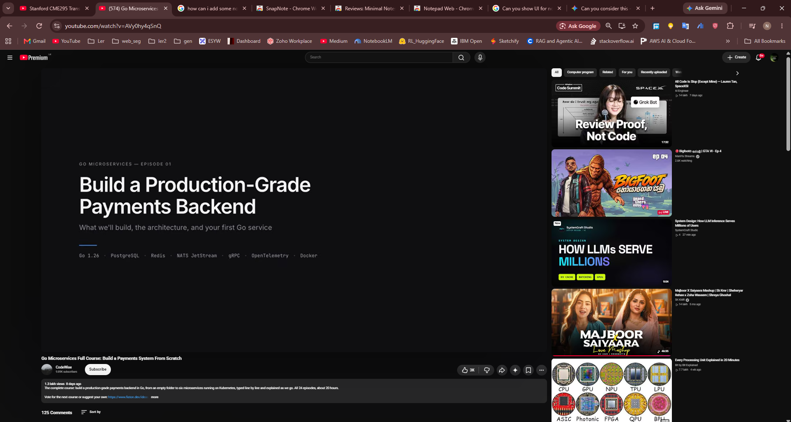

# Here some features i like to include to this more than side note one, 

-- A quection i ask from the browser gemini tab 

--- I need to save this opended, tabs into folder naming folder some name so i can use it in after days, so how can i do that 

--- Serverless Gmail & Google Drive Encrypted Sync (Later Phase): Link the extension to Gmail (`chrome.identity` / Google OAuth2) and store notes + saved tab folders as a client-side encrypted file (`AES-256-GCM`) in Google Drive. When signing in with the same email on another browser/workstation, automatically extract and decrypt the notes without needing a dedicated backend server.

Consider this image -->  